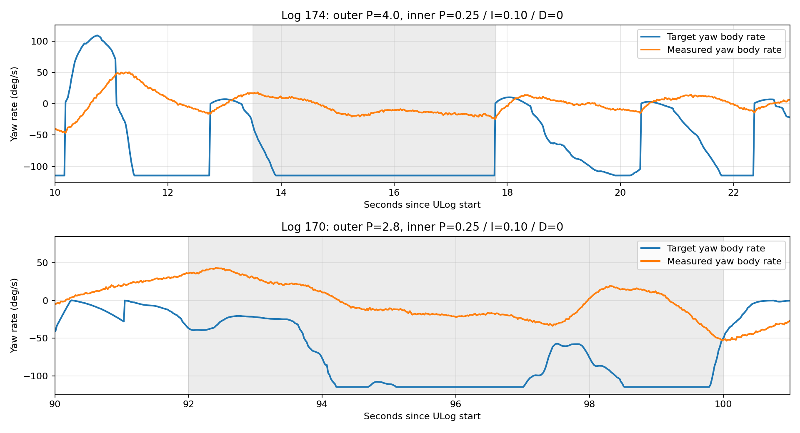

# 两份飞行日志的偏航响应分析

## 结论与建议

日志支持先处理角速度内环及其后面的执行器响应，暂不继续增加姿态外环 P。建议在核对偏航差动与公共倾转的实际作用方向一致、机构正常后，将 `FV_ANG_VEL_P_Z` 从 0.25 小步调到 0.30；如果实际角速度跟随改善、没有新增振荡或明显超调，再试 0.35。内环 I 先保持 0.10，D 保持 0。

2026-11-01 最终选定的下一轮验证配置为 **外环 P=4.0、内环 P=0.30**，已更新 `src/modules/fullvector_control/module.yaml` 并通过 `make px4_fmu-v6x_default` 编译。下文“系数怎样调”保留日志分析时的分步试调建议，采用外环 2.8 的建议基线与最终选定配置不同。两份历史日志均未验证新组合，不能把编译成功视为飞行性能验证。

这是一组后续验证的候选值，不是从日志辨识出的最优 PID。两份日志包含模式切换、视觉相对航向切换和不同摇杆输入，不能作为相同阶跃输入的严格对照，也无法单凭日志排除气动阻力、机构间隙、力矩方向或模型标定问题。

## 数据与方法

- 输入：`docs/log_170_UnknownDate.ulg` 和 `docs/log_174_UnknownDate.ulg`。
- 日志时长分别为 107.79 s、40.57 s；没有 ULog dropout 记录。两份日志固件版本都是 `3d1ccc411f91daf220cf993f1edec1389ee84755`，所涉及的 fullvector 控制实现与分析时的提交 `4bba7d0fc09204344dc47cc75769f7fa712435df` 相同。
- 参数取自 ULog 的 initial_parameters；两份日志都没有记录飞行中的参数修改。除飞行计数/时长参数外，两份日志只有 `FV_ATT_P_Z` 不同。
- 统计仅选择已解锁、land detector 判定未着陆、fullvector 激活且控制目标有效的样本。有效片段约为 log 170 的 1.47–106.41 s 和 log 174 的 1.05–38.67 s。起降片段仍可能包含在该自动筛选内，因此关键结论另选中段持续输入窗口验证。
- 时间一律从 ULog 的 start_timestamp 起算，不是上电时间或解锁时间。
- 内环实际角速度由同一条诊断中的 `angular_velocity_sp[2] - angular_velocity_error[2]` 得到，避免异步日志对齐造成虚假的跟踪误差。这是机体 Z 轴角速度 r，不是严格的欧拉航向角导数。其与最近一条 vehicle_angular_velocity 的 RMS 差为 0.018、0.025 rad/s，远小于下述跟踪误差。
- 控制输出、模式和执行器指令使用最近过去样本对齐。执行器指令不是实测转速或舵机位置；诊断饱和标志只反映软件输出达到上下限。

## 实际使用的参数

| 参数 | log 170 | log 174 |
|---|---:|---:|
| FV_ATT_P_Z | 2.8 | 4.0 |
| FV_ATT_I_Z / FV_ATT_D_Z | 0 / 0 | 0 / 0 |
| FV_ANG_VEL_P_Z | 0.25 | 0.25 |
| FV_ANG_VEL_I_Z | 0.10 | 0.10 |
| FV_ANG_VEL_D_Z | 0 | 0 |
| FV_YAW_MIX_WT | 0.5 | 0.5 |
| FV_YAW_TILT_MAX | 0.175 rad | 0.175 rad |
| FV_INERTIA_ZZ | 0.11 kg·m² | 0.11 kg·m² |

这两份日志没有验证外环 P=5，也没有验证内环 P=0.30。当前源码默认值为外环 P=4.0、内环 P=0.30；日志中的运行参数仍以上表为准。

## 关键证据

下表是各窗口内的有符号均值，不能把均值之比当作阶跃响应增益，也不能由此计算上升时间。

| 日志及窗口 | 模式 / 航向误差来源 | 目标偏航角速度均值 | 实际偏航角速度均值 | 角加速度指令均值 | 软件执行器饱和 |
|---|---|---:|---:|---:|---:|
| 170，32–44 s | Position / 绝对 | −49.4°/s | −3.2°/s | −0.229 rad/s² | 0% |
| 170，92–100 s | Position / 绝对 | −86.5°/s | −1.7°/s | −0.400 rad/s² | 0% |
| 174，13.5–17.8 s | Stabilized / 绝对 | −110.4°/s | −8.0°/s | −0.476 rad/s² | 0% |
| 174，29–32 s | Position / 绝对 | −78.3°/s | −3.3°/s | −0.358 rad/s² | 0% |

1. **外环已经给出了较强目标。** log 174 的 13.5–17.8 s 中，目标角速度有 90.2% 的样本达到 ±2 rad/s 的手动限幅，航向误差的绝对值 P95 达 34.38°，对应源码里的 0.6 rad 手动航向误差上限。外环增益继续提高，主要会让目标更早进入限幅，无法直接增加已经限幅后的指令。
2. **位置模式也存在明显的内环跟踪不足。** log 170 的 32–44 s、92–100 s 以及 log 174 的 29–32 s，姿态 yaw 误差为零，而角速度目标仍显著偏离实际值。这符合源码在 Position 模式打 yaw 杆时直接使用角速度目标的路径，说明迟缓并非只来自姿态外环。
3. **当前角加速度限幅不是瓶颈。** 两份日志有效飞行样本中，偏航角加速度指令绝对值最大分别只有 0.680、0.721 rad/s²，远低于手动模式的 4 rad/s² 限幅。log 170 完全没有软件执行器饱和；log 174 只有 2 个样本（约 0.11%）出现电机上限饱和，关键持续输入窗口均为零。没有证据支持先放宽这些限制。
4. **持续控制指令已经传到执行器发布端。** log 174 的 13.5–17.8 s，电机控制指令在 0.386–0.680，两组电机指令和之差 `(m1+m2)-(m3+m4)` 均值为 −0.264。四舵机指令按 FV_TILT_MAX 换算后的公共倾转均值约 −0.237°，明显小于 10° 的 yaw 倾转上限。这是指令值，不能证明实物舵机完成了该角度，也不能据此确认真实 yaw 力矩大小。

整体角速度误差 RMS 分别为 0.845、1.302 rad/s；因为两次输入和模式占比不同，不应把该差异直接解释成“外环 P 从 2.8 增到 4 导致性能变差”。能确认的是两次均未获得良好的内环跟随。

## 系数怎样调

| 参数 | 建议 | 理由及下一步 |
|---|---|---|
| FV_ATT_P_Z | 分步试调建议固定在 2.8；内环跟随正常后再评估 3–4 | 使用已飞过的低值建立基线，避免同时改变两个环。最终选定的下一轮验证配置为 4.0，见本文开头。Position 主动 yaw rate 片段的目标不靠外环 P 放大。 |
| FV_ANG_VEL_P_Z | 0.25 → 0.30，改善且无新增振荡后 → 0.35 | 优先增强角速度误差对应的即时控制量；每次只改一项，使用相同的小幅左右输入比较。若改到 0.35 仍几乎不跟随，先查分配/机构，不继续盲目加大。 |
| FV_ANG_VEL_I_Z | 首轮保持 0.10 | 手动模式积分状态限制 ±0.3，因此该项最多贡献 ±0.03 rad/s²。它对当前大角速度误差的补偿很有限；不能靠增加 I 代替 P 和分配检查。P 调好后若仍有同向残差，再单独考虑 0.12–0.15。 |
| FV_ANG_VEL_D_Z | 保持 0 | 日志不支持为改善启动迟缓而先增加 D。当前实现对误差做差分，增加 D 还会改变目标跳变时的瞬态。 |
| FV_YAW_MIX_WT | 首轮保持 0.5 | 先分别核对电机差动、公共倾转产生的真实力矩方向是否一致。现有日志不能判定应往 0 还是 1 调。 |
| FV_YAW_TILT_MAX、手动角速度/角加速度上限 | 保持 | 当前没有证据表明这些限幅阻碍了执行器输出；角速度目标已经足够大。 |

在日志中的内环 P=0.25、I 项最大贡献约 0.03 的条件下，若角速度误差为 1 rad/s，指令约为 0.25+0.03=0.28 rad/s²；改 P=0.30 后约为 0.33 rad/s²。这里只是控制器输出幅度的计算，不能据此预测实机上升时间。控制分配包含平方根和转速平方映射，实际力矩不会严格按 P 成比例增长。

## 为什么还要查分配与机构

持续数秒的同向偏航控制下，实际角速度仍偏小，有的短片段还与目标反向。这比单纯启动慢更值得关注，但日志不足以证明接反或硬件故障。应核对电机分组/旋向、公共倾转的机械方向、舵机零位和小指令响应，以及机体是否受到外部约束。

源码中的电机 yaw 分量使用 `signed_sqrt(Izz * weight * angular_accel / (4 * K_F * distance))`，之后与基础转速相加；前向力矩模型则使用 `K_M*(w1²+w2²-w3²-w4²)`。这不是严格的 yaw 力矩逆分配，不能把标准 PX4 的 MC_YAWRATE_P 数值直接套到这里，也不能按目标/实际速度的比值把 P 放大十倍。该代码现象本身不能证明此次响应问题的根因。

建议用固定模式、绝对姿态来源、相同幅度的左右短脉冲/保持/松杆片段做复测。比较目标与实际角速度的跟随、松杆后反向超调，以及电机/舵机输出。若输出增强但实机 yaw 仍不明显增强，应优先处理执行器或分配，而不是继续叠加 PID。

调参顺序参考 [PX4 PID 调参指南](https://docs.px4.io/main/en/config_mc/pid_tuning_guide_multicopter)：先完成角速度内环，再调整姿态外环。具体参数和限幅以上述自定义 fullvector 实现为准。

## 产物与复现

- `analyze.py`：使用 pyulog、numpy、matplotlib 读取原始日志并生成指标和图表。
- `metrics.json`：全飞行、按模式/误差源分组及所选窗口的统计。
- `yaw_comparison.png`：关键片段对比。
- `log_170_yaw.png`、`log_174_yaw.png`：完整日志曲线。
- `log_170_yaw_detail.png`、`log_174_yaw_detail.png`：关键片段的角速度、航向误差、角加速度指令、电机指令与公共倾转指令。

复现依赖：Python 3、`pyulog`、`numpy`、`matplotlib`。原始 ULog 文件为本地分析输入，不包含在本次代码提交中；复现时需先将上述两份日志放到仓库的 `docs/` 目录，再运行 `python3 docs/yaw_log_analysis/analyze.py`。指标 JSON 和图表作为分析产物随文档保存。

分析阶段没有修改控制参数；后续已按最终选定配置更新源码默认值并生成固件，没有向飞控写入任何值。固件路径为 `build/px4_fmu-v6x_default/px4_fmu-v6x_default.px4`，构建产物不纳入 Git。刷写后如需应用新默认值，仍应检查并设置飞控中的已保存参数，操作见[控制器说明](../../src/modules/fullvector_control/FULLVECTOR_CONTROL.md#84-当前偏航参数默认值与日志验证)。
